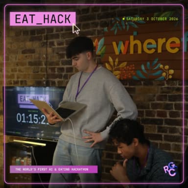

# Hola, I'm Oriol Morros

**AI Engineer at RGC · London**  
Building AI products and retail intelligence tools.

## About me

Originally from Barcelona, now living in London. I never really stop building, from personal projects that solve everyday problems to small automations that make my life easier.

I'm going deeper into AI engineering and regularly join hackathons to meet people, build projects, try new tools, and discover what's happening across the startup ecosystem.

Outside of code, basketball has been my favourite sport for as long as I can remember. I also spend time at the gym, enjoy cooking, and play chess whenever I have some free time.

Read some of my stories away from the keyboard:

<table align="center">
  <tr>
    <td align="center" valign="top" width="180">
      
       <strong>EAT HACK</strong>
       <a href="https://www.omorros.com/journal/eat-hack">Read more →</a>
    </td>
    <td align="center" valign="top" width="180">
      
       <strong>Basketball</strong>
       <a href="https://www.omorros.com/journal/basketball">Read more →</a>
    </td>
    <td align="center" valign="top" width="180">
      
       <strong>1.5M followers</strong>
       <a href="https://www.omorros.com/journal/social-media">Read more →</a>
    </td>
  </tr>
</table>

## Hackathons

**9 wins across 7 hackathons · 2026**

- 🏆 **Voice AI Hack London** — Overall Winner · [TrueVoice](https://omorros.com/projects/truevoice)
- 🏆 **{Tech: Europe} × VEED** — Overall Winner & Best Use of fal · [Lantern](https://omorros.com/projects/lantern)
- 🏆 **Unicorn Mafia × Techbible** — Overall Winner · [WILDSCAN](https://omorros.com/projects/wildscan)
- 🏆 **On-Device Agent Hackathon** — Cosine & EXO Labs Track Winner · [OffBabel](https://omorros.com/projects/offbabel)
- 🏆 **Superlinked × Alibaba Cloud Qwen** — Track Winner · Echo
- 🏆 **Real-World Agents Hackathon** — People's Choice · Hamyway City
- 🏆 **Tokens LDN Multi-Agent Hackathon** — Best Use of Tavily, 1st Place · Basket

[Projects and hackathon results →](https://omorros.com/hackathons)

## Open source

18 merged pull requests in [IBM MCP Context Forge](https://github.com/IBM/mcp-context-forge).

[All contributions →](https://github.com/omorros/open-source)

## Connect

